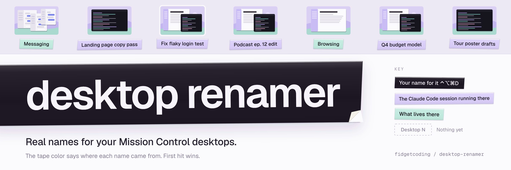

<a id="top"></a>

<div align="center">



[](https://x.com/fidgetcoding) [](https://www.linkedin.com/in/nate-davidovich/) [](https://youtube.com/@fidgetcoding) [](https://instagram.com/fidgetcoding)

</div>

# Desktop Renamer

**Real names on your desktops in Mission Control, so "Desktop 4" can finally say what it's for.**

More: [EVOLUTION.md](EVOLUTION.md) (how it came together)

<!-- TODO(screenshot): a real Mission Control screenshot with the names showing goes here.
Save it as assets/screenshot.png, then replace this comment with:

-->

> [!NOTE]
> **Heads up, this was fidgetcoded.** I built it for my own Mac in a day and it works great there. It reads Mission Control's layout at runtime, so a macOS update could knock the names a few points off. If that happens, open an issue with a screenshot and I'll look.

## What it does

Swipe up into Mission Control and every desktop wears a real name in the top bar, in both the slim strip and the big hover view with thumbnails. The name is drawn right over the "Desktop N" label, in a chip filled with the bar's own colour, so it looks like it was always there. Clicks go straight through to the real label underneath.

Most desktops name themselves:

- A desktop running a **Claude Code** session takes the session's topic as its name, and renames itself when the topic changes.
- A desktop full of chat apps reads **Messaging**. A desktop with only the browser reads **Browsing**. You write these rules yourself.
- Anything else shows its two front apps, like **Mail · Slack**.
- And when you want a name of your own, press **⌃⌥⌘D** on that desktop and type it.

It's one Lua file for [Hammerspoon](https://www.hammerspoon.org): copy it in, add one line, done.

## Why I made it

I run eight or nine desktops, most of them with a Claude Code session going, and Mission Control calls every single one "Desktop N". Finding the right one meant opening Mission Control and squinting at tiny thumbnails of terminal windows that all look the same.

macOS has no setting to rename desktops and no API for it either. My first two tries put the names somewhere else: a popup on every desktop switch (I hated it) and a menu bar item (wrong place, since the place I actually look is Mission Control). So this one paints the names onto Mission Control itself.

## Install

Built and tested on macOS 26. You need Hammerspoon.

1. **Install Hammerspoon** if you don't have it:
   ```sh
   brew install --cask hammerspoon
   ```
   Open it once and turn it on in **System Settings → Privacy & Security** under both **Accessibility** and **Screen Recording**. (What each one is for is under [Known limits](#known-limits).)

2. **Drop the file into your Hammerspoon folder:**
   ```sh
   curl -fsSL https://raw.githubusercontent.com/fidgetcoding/desktop-renamer/main/desktop-names.lua \
     -o ~/.hammerspoon/desktop-names.lua
   ```

3. **Add one line** to `~/.hammerspoon/init.lua` (create the file if it doesn't exist):
   ```lua
   require("desktop-names")
   ```

4. **Reload Hammerspoon:** click its menu bar icon → **Reload Config**.

5. **Open Mission Control.** Desktops it already knows show their names right away. The rest pick theirs up the first time you switch to them.

**Prefer to stay up to date with git?** That's how I run it:

```sh
git clone https://github.com/fidgetcoding/desktop-renamer.git ~/code/desktop-renamer
ln -s ~/code/desktop-renamer/desktop-names.lua ~/.hammerspoon/desktop-names.lua
```

Then add the same `require` line, and `git pull` whenever you want the latest.

### Let your agent set it up

Paste this into Claude Code (or any coding agent with a terminal):

```text
Install desktop-renamer from https://github.com/fidgetcoding/desktop-renamer on this Mac.
Install Hammerspoon with Homebrew if it's missing. Download desktop-names.lua into
~/.hammerspoon/ and add require("desktop-names") to ~/.hammerspoon/init.lua without
removing anything already there. Then tell me to grant Hammerspoon Accessibility and
Screen Recording in System Settings and to click Reload Config in its menu bar icon.
Don't open Mission Control yourself.
```

## How names get picked

For each desktop, the first match wins:

1. **Your own name**, set with ⌃⌥⌘D on that desktop. It beats everything. Save it empty to go back to automatic.
2. **A terminal title.** The most recently used Ghostty window on that desktop names it. Claude Code keeps the terminal title set to what the session is about, so these desktops name themselves. The little status symbol at the front (◐, ✳) gets cut.
3. **A category**, when the apps on that desktop match one of your rules (Messaging, Browsing).
4. **The two front apps**, like "Mail · Slack".
5. **Nothing.** The normal "Desktop N" label stays.

Names stick to the desktop itself, so a name follows its desktop when you drag it to a new spot in Mission Control. Close a desktop and its name goes with it.

## The hotkey

**⌃⌥⌘D** (Control-Option-Command-D) opens a small box to name the desktop you're on. Leave it empty and press Save to hand the naming back to the automatic rules.

## Settings

Everything you'd want to change sits in one table at the top of `desktop-names.lua`. It ships with my own rules as working examples:

```lua
local SETTINGS = {
  renameHotkey = { mods = { "ctrl", "alt", "cmd" }, key = "D" },  -- false turns it off
  titleApps = { "Ghostty" },                     -- whose window title names a desktop
  titleCuts = { "%s*|%s*BRAIN2$" },              -- bits cut out of those titles
  categories = {
    { name = "Messaging", any = { "Messages", "Telegram", "Signal", "WhatsApp" } },
    { name = "Browsing", only = { "Arc" } },
  },
  frontApps = 2,                                 -- how many apps to list otherwise
}
```

- **`categories`**: rules are checked top to bottom. `any` matches when at least one of those apps is on the desktop; `only` matches when those are the only apps there. So with my rules, a desktop with Arc and WhatsApp reads "Messaging". App names match loosely, so "Telegram" also catches "Telegram Desktop". Add a rule and reload, and desktops it already knows get relabelled right away.
- **`titleApps`**: add your terminal here if it isn't Ghostty. I've only tested Ghostty.
- **`titleCuts`**: [Lua patterns](https://www.lua.org/manual/5.4/manual.html#6.4.1) removed from those titles. Mine strips the " | BRAIN2" my shell tacks on. Swap in your own or leave the list empty.

## Screenshots work

Any click or key inside Mission Control hides the names for half a second, so they never hang around while you're switching. Screenshots are the exception: **⌘⇧3, ⌘⇧4, ⌘⇧5 and ⌘⇧6** leave the names on screen, including the drag-to-select part of ⌘⇧4. Your screenshots show what you see.

## How it compares

Others got here first, so here's the honest lay of the land:

- **[DeskStag](https://deskstag.com)**: a polished paid app ($23.99 once, 14-day trial, Apple silicon). You click a desktop's label in Mission Control and type a name, and it draws it there. Pick it if you want a supported app and are happy naming every desktop by hand.
- **[SpaceNamer](https://github.com/AlexanderCollins/spacenamer)**: free, open source, and the closest cousin to this one. It's a full menu bar app you build with Apple's developer tools. You get names in Mission Control's bar, a switcher, shortcuts, and Claude Code session titles through its own plugin. Pick it if you want all of that.
- **[SpaceNames](https://github.com/jrp-git/SpaceNames)**: free and open source. It hangs a small flag with your name under each Mission Control thumbnail, and you name them by hand.
- **[Spaces Renamer](https://github.com/dado3212/spaces-renamer)**: the long-running original. It renames the real labels from inside the part of macOS that draws the bar. Version 2 needs macOS 27; older macOS versions need MacForge, a tool that loads plugins into system apps.
- **[Spaceman](https://github.com/Jaysce/Spaceman)** and **[WhichSpace](https://github.com/gechr/WhichSpace)**: show which desktop you're on in the menu bar. They don't touch Mission Control.

**Why this one, then?** If you already use Hammerspoon, it's one file and one line. Most of your desktops name themselves from what's on them, and the rules are a few lines you can read and change. The only app you install is Hammerspoon.

## Known limits

- **macOS 26.** I measured Mission Control's layout on macOS 26 (Tahoe): a 72-point bar collapsed, 164 points expanded. Other versions may put the names a few points off, or skip them.
- **Two permissions.** Accessibility lets Hammerspoon read where Mission Control puts each label, watch for the click or key that closes it, and run the hotkey. Screen Recording lets it sample the bar's colour so each name blends in. Without Screen Recording, the names sit on flat grey chips.
- **Visit first.** Hammerspoon only sees windows on desktops you've visited since it started. Names are saved, so the last known name shows until you visit that desktop again.
- **One display.** I built and tested this with one display. Several displays aren't handled yet.
- **Your titles stay local.** Names and the colour cache live in `~/.hammerspoon/desktop-names.json`, which holds your session titles. Keep that file out of any repo you share (this repo's `.gitignore` already skips it).
- **Ghostty only, so far.** Other terminals may work through `titleApps`, but I haven't tried them.

## Uninstall

Delete the `require("desktop-names")` line from `~/.hammerspoon/init.lua`, then:

```sh
rm ~/.hammerspoon/desktop-names.lua ~/.hammerspoon/desktop-names.json
```

Reload Hammerspoon and Mission Control goes back to "Desktop N".

---

## License

MIT — see [LICENSE](LICENSE).

---

Built by [Nate Davidovich / Lorecraft](https://github.com/fidgetcoding)

[⤴ back to top](#top)
